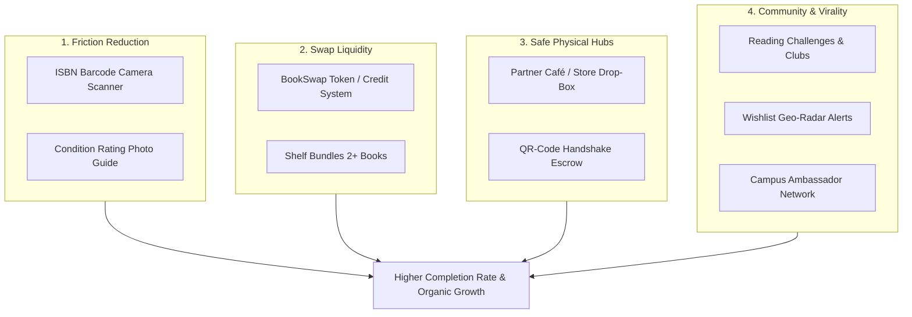

# Global Benchmarks & Strategic Improvement Roadmap for BookSwap (بدّلها)

## 1. Executive Summary

**BookSwap (بدّلها)** is uniquely positioned at the intersection of a **peer-to-peer book marketplace**, an **eco-conscious book-swapping community**, and a **hyper-local literary network**. 

While general classifieds (e.g., OLX, Dubizzle, Facebook Marketplace) suffer from scam risks, friction, and lack of book-specific metadata, dedicated global platforms like **PangoBooks**, **BookMooch**, and **Vinted** have proven that niche circular marketplaces create high customer retention, passionate communities, and sustainable business models.

This document analyzes the world's leading models and provides concrete, prioritized recommendations tailored directly to BookSwap's current architecture (Next.js, Supabase, Leaflet, QR codes, and Egyptian urban hubs).

---

## 2. In-Depth World Benchmarks & What to Learn

### A. PangoBooks (USA / Global) — *The Benchmark for Modern Book UX*
* **Core Model:** Peer-to-peer mobile & web marketplace dedicated 100% to books.
* **Why it thrives:**
  * **15-Second Listing via ISBN:** Sellers scan the book's barcode; the platform pulls the cover, title, author, synopsis, and original price automatically. The seller only snaps 2 photos and sets the condition.
  * **"BookTok" Aesthetics & Social Shelves:** Users curate aesthetic profiles ("My Dark Academia Shelf", "Sci-Fi Must-Reads"), turning shopping into browsing a friend's curated library.
  * **Shelf Bundling:** Sellers can offer discounts when buyers take 2+ books from their shelf, increasing average order value and saving on shipping.
* **Key Lesson for BookSwap:** Reduce listing friction to near zero. Reading culture is visual and social; make browsing profiles feel like browsing someone's living room bookshelf.

---

### B. BookMooch & PaperBackSwap — *Solving the Swap Dilemma*
* **Core Model:** 100% exchange network using an internal **Points/Token Economy**.
* **The Problem they solved:** The **"Double Coincidence of Wants"** trap:
  * If User A has *Dune* and wants *1984*, and User B has *1984* but wants *Harry Potter*, a direct 1-to-1 swap fails.
* **How their system works:**
  1. User A sends *Dune* to User C $\rightarrow$ User A earns **1 Point**.
  2. User A uses that **1 Point** to claim *1984* from User B.
  3. No money changes hands; every exchange is asymmetric and friction-free.
* **Key Lesson for BookSwap:** Pure 1-to-1 swapping creates high transaction drop-off. Introducing a **Swap Credit / Token** system unlocks unlimited liquidity in your community.

---

### C. Vinted & Wallapop (Europe) — *Solving Logistics & Trust*
* **Core Model:** Massive circular economy apps powered by **PUDO (Pick-up / Drop-off)** networks.
* **Why it works:**
  * **Zero Seller Fees:** Listing and selling is free for the seller, ensuring maximum supply.
  * **Buyer Protection Fee:** Buyers pay a nominal fee (e.g., 5-8% + small flat rate) which funds escrow, dispute resolution, and customer service.
  * **Parcel Lockers & Local Hubs:** Instead of home delivery (which requires waiting for couriers), items are dropped off at automated lockers or partner corner stores (InPost / Mondial Relay).
* **Key Lesson for BookSwap:** Books often have low price points (e.g., 50–150 EGP). High courier costs kill deals. Using **Partner Cafés and Bookstores** as local drop-off/pick-up lockers is your competitive moat.

---

### D. Little Free Library — *Hyper-Local Physical Mapping*
* **Core Model:** Over 150,000 physical community boxes around the world pinned on an interactive map.
* **Why it works:** People love the spontaneous serendipity of finding a book in their immediate neighborhood without commercial pressure.
* **Key Lesson for BookSwap:** Your `leaflet` integration and existing Alex/Cairo meetups (`Bibliotheca Alexandrina`, `San Stefano`, `The GrEEK Campus`, `Maadi Degla`) can be expanded into official "BookSwap Drop Zones".

---

### E. StoryGraph & Goodreads — *Intent-Driven Discovery*
* **Core Model:** Social reading trackers, reading challenges, and TBR ("To Be Read") lists.
* **Why it works:** Millions of readers maintain active wishlists of books they intend to read next.
* **Key Lesson for BookSwap:** Connect **Wishlists directly to Geo-Alerts**. When Reader A wants a book and Reader B lists it within 5 km, alert Reader A immediately: *"The book on your wishlist was just listed nearby!"*

---

## 3. Comprehensive Feature & UX Improvement Roadmap

---

### Stream 1: Frictionless Listing & Quality Control

#### 1. Instant ISBN Scanner & Auto-Fill
* **Implementation:** Use the device camera with a client-side barcode reader (`@zxing/library` or `html5-qrcode`).
* **Data Sources:** Query **Google Books API** or **OpenLibrary API** using the scanned ISBN.
* **Result:** Automatically populates Title, Author, Cover Art, Category, Number of Pages, and Synopsis.
* **Time Saved:** Drops listing creation time from **2.5 minutes down to 20 seconds**.

#### 2. Visual Condition Standards
To eliminate disputes like *"The listing said 'Like New' but the spine is cracked and notes are in pencil"*:
* Provide an interactive guide with mandatory photo slots:
  1. Front cover
  2. Spine
  3. Page edges (top/side)
  4. Any damage / markings
* Standardized tags: `Clean Copy`, `Some Highlighting`, `Gift Inscription`, `Collector's Edition`.

---

### Stream 2: Solving the Swap Problem (Liquidity & Economics)

#### 1. Hybrid "Swap Credit" Economy (نقاط بدّلها)
* Introduce a token balance in user profiles.
* **Flow:**
  * Give a book via `GIVEAWAY` or `SWAP` $\rightarrow$ Receive **1 Swap Point**.
  * Spend **1 Swap Point** to claim any eligible book marked as `SWAP_CREDIT`.
* **Direct Swap remains available:** Users can still negotiate 1-to-1 swaps if both parties agree.

#### 2. Multi-Book Shelf Bundles
* Allow sellers to enable: *"Swap 2 books from my library for 1 rare book"* or *"Get 20% off when buying 3 books together"*.
* Saves courier charges or coordinates fewer in-person meetups.

---

### Stream 3: Logistics & Hyper-Local "Safe Hubs"

#### 1. "Leave & Collect" at Partner Cafés / Bookstores
* Build on your existing `stores` and `meetup-picker.tsx`:
  * Instead of two busy people trying to find a matching 30-minute window at Raml Station or Maadi Degla, User A drops the book off at **Partner Café X**.
  * The café staff scans User A's QR code (confirming deposit).
  * User B has 48 hours to pick it up and scan their confirmation QR code.
* **Win-Win:**
  * **Users:** Zero scheduling headaches.
  * **Partner Cafés:** Guaranteed foot traffic from readers who often purchase coffee while picking up books.

#### 2. University Campus Clusters
* Create dedicated filters and hubs for major universities (Cairo University, Ain Shams, Alexandria University, AUC, GUC, AASTMT).
* Academic textbooks and student novel exchanges have the highest seasonal velocity (beginning & end of each semester).

---

### Stream 4: Social Virality & Retention

#### 1. Wishlist Radar & Instant Match Notifications
* When a user marks a book as **"Want to Read / Wishlist"**:
  * Send immediate push/email alerts when that book is listed within their city or university.
  * Show a badge on listings: *"3 people in your neighborhood are looking for this book!"* (nudging owners to list their copies).

#### 2. Reading Challenges & "Pass-the-Book" Chains
* **Annual Reading Challenge:** "Read 12 books in 2026 without buying new".
* **Book History Log:** Add a digital passport inside BookSwap where every reader who held this specific physical copy can leave a short note or date: *"Read in Alexandria, March 2026 - Loved Chapter 4"*.

---

## 4. Prioritized Action Plan for the Development Team

| Priority | Feature | Effort | Impact | Target Component / Area |
| :--- | :--- | :--- | :--- | :--- |
| **P0 (Immediate)** | **ISBN Barcode Scanner** | Medium | 🔥 High | `src/app/books/new` & OpenLibrary API |
| **P0 (Immediate)** | **Wishlist Geo-Matching Alerts** | Low | 🔥 High | Supabase Database Webhook / Edge Function |
| **P1 (Near Term)** | **Shelf Bundling & Multi-Book Offers** | Medium | High | `src/components/stores/offers-hub-client.tsx` |
| **P1 (Near Term)** | **Partner Café Drop-Off Flow** | Medium | High | `src/components/ui/meetup-picker.tsx` & `stores` |
| **P2 (Growth)** | **Swap Points / Token Balance** | High | 🔥 High | `supabase/schema.sql` (Wallets / Credits table) |
| **P2 (Community)**| **Reading Clubs & Campus Hubs** | Medium | Medium | `src/app/communities/page.tsx` |
