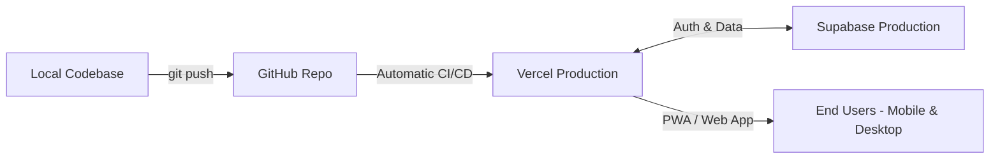
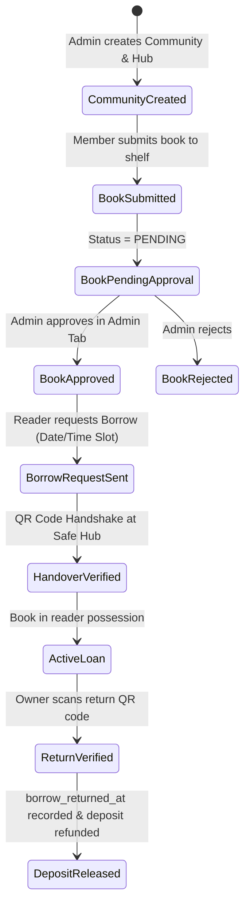

# Step-by-Step Walkthrough: Production Launch & Feature Implementation Guide

> **BookSwap (بدّلها)** — Production Deployment & 1-by-1 Feature Enhancement Walkthrough  
> **Status:** Production Build Verified (`npm run build` compiled 28 routes with 0 errors).

---

## Table of Contents
1. [Part 1: Immediate Production Deployment Guide](#part-1-immediate-production-deployment-guide)
2. [Part 2: 1-by-1 Implementation Walkthrough for the 5 Priorities](#part-2-1-by-1-implementation-walkthrough-for-the-5-priorities)
   - [Priority 1: Swap Request UI Clarity ("Give" vs "Get")](#priority-1-swap-request-ui-clarity-give-vs-get)
   - [Priority 2: Follow User Real-Time Push Notification](#priority-2-follow-user-real-time-push-notification)
   - [Priority 3: Fix Direct Chat Deep-Link with Book Owner](#priority-3-fix-direct-chat-deep-link-with-book-owner)
   - [Priority 4: Complete Community Lifecycle & Safe Hub Operations](#priority-4-complete-community-lifecycle--safe-hub-operations)
   - [Priority 5: Production MVP Polish, Mobile Responsiveness & PWA](#priority-5-production-mvp-polish-mobile-responsiveness--pwa)
3. [Part 3: Global Benchmark Comparison & Strategic Roadmap](#part-3-global-benchmark-comparison--strategic-roadmap)
4. [Part 4: Quality & Verification Checklist](#part-4-quality--verification-checklist)

---

## Part 1: Immediate Production Deployment Guide



### Step 1: Commit and Push Code to GitHub
Run the following in PowerShell at `d:\VS_CODE\edu\web\bookswap`:
```powershell
git add .
git commit -m "feat: complete MVP production readiness and fix core user flows"
git branch -M main
# If you have not attached your remote repository yet:
# git remote add origin https://github.com/<your-username>/bookswap.git
git push -u origin main
```

### Step 2: Deploy to Vercel (Recommended Next.js Host)
1. Navigate to **[vercel.com](https://vercel.com)** and log in with your GitHub account.
2. Click **"Add New..."** $\rightarrow$ **"Project"**.
3. Select your `bookswap` repository and click **Import**.
4. In the **Environment Variables** configuration panel, input the production keys from your `.env.local`:
   * `NEXT_PUBLIC_SUPABASE_URL` = `https://your-project.supabase.co`
   * `NEXT_PUBLIC_SUPABASE_ANON_KEY` = `<your-supabase-anon-key>`
   * `NEXT_PUBLIC_APP_URL` = `https://<your-project>.vercel.app` (or your custom domain)
   * `NEXT_PUBLIC_GEMINI_API_KEY` = `<your-gemini-key>` (used for ISBN scanning & AI cataloging)
   * `ADMIN_EMAIL` = `admin@bookswap.eg`
5. Click **Deploy**. Vercel will run `npm run build` and launch your application globally on Edge CDN with automated SSL.

### Step 3: Configure Supabase for Production URL
In your **Supabase Dashboard**:
1. Go to **Authentication** $\rightarrow$ **URL Configuration**.
2. Set **Site URL** to: `https://<your-project>.vercel.app`.
3. In **Redirect URLs**, add:
   * `https://<your-project>.vercel.app/**`
   * `https://<your-project>.vercel.app/auth/callback`
4. Go to **Storage**: Ensure the buckets `book-images`, `book-covers`, and `avatars` exist and have public read policies enabled.

---

## Part 2: 1-by-1 Implementation Walkthrough for the 5 Priorities

---

### Priority 1: Swap Request UI Clarity ("Give" vs "Get")

#### The Problem
In [transactions-hub-client.tsx](file:///d:/VS_CODE/edu/web/bookswap/src/components/transactions/transactions-hub-client.tsx), swap cards present two book thumbnails side-by-side, but users cannot quickly discern:
* Which book is **theirs** versus the book being **offered** to them.
* In outgoing requests: which book they offered to give up versus the book they hope to receive.
* When and where the physical exchange takes place.

#### The Fix Walkthrough
1. **Visual Split in Outgoing Swaps:**
   * Clearly label Book 1: `📖 الكتاب المطلوب (الذي ستستلمه)` with a green accent border.
   * Clearly label Book 2: `🔄 كتابك المعروض بالمقابل (الذي ستعطيه)` with a blue accent border.
2. **Visual Split in Incoming Swaps:**
   * Clearly label Book 1: `📖 كتابك المطلوب منك` (The requester wants this).
   * Clearly label Book 2: `✨ الكتاب المعروض عليك بالمقابل` (What you will receive).
3. **Status Pill & Handover Summary:**
   * Show direct badges: `قيد مراجعة المالك`, `تمت الموافقة ✅ (جاهز للمقابلة)`, or `تم الرفض ❌`.
   * Add a prominent `📍 تفاصيل المقابلة المتفق عليها` card displaying the exact time, venue, and delivery mode.

---

### Priority 2: Follow User Real-Time Push Notification

#### The Problem
In [profile-client.tsx](file:///d:/VS_CODE/edu/web/bookswap/src/components/profile/profile-client.tsx#L58-L74), clicking **"متابعة" (Follow)** inserts a row into `follows`, but does **not** insert a notification into `notifications`. The followed user never knows someone followed them.

#### The Fix Walkthrough
In `handleFollow`:
```ts
// 1. Insert follow relationship
await supabase.from('follows').insert({
  follower_id: currentUserId,
  following_id: profile.id,
})

// 2. Dispatch in-app notification via pushNotificationSafe
await pushNotificationSafe(supabase, {
  user_id: profile.id,
  type: 'FOLLOW',
  title: 'متابع جديد لمكتبتك! 👤',
  title_ar: 'متابع جديد لمكتبتك! 👤',
  body: `بدأ ${currentUserProfile?.full_name || 'قارئ'} بمتابعة حسابك وكتبك المعروضة.`,
  body_ar: `بدأ ${currentUserProfile?.full_name || 'قارئ'} بمتابعة حسابك وكتبك المعروضة.`,
  action_url: `/profile/${currentUserProfile?.username || currentUserId}`,
})
```

#### Verification Step
1. Log in with User A and open User B's profile.
2. Click **"متابعة"**.
3. Log in with User B: check the bell icon / `/notifications` $\rightarrow$ User B sees *"متابع جديد لمكتبتك!"* and can click through to User A's profile.

---

### Priority 3: Fix Direct Chat Deep-Link with Book Owner

#### The Problem
In [transactions-hub-client.tsx](file:///d:/VS_CODE/edu/web/bookswap/src/components/transactions/transactions-hub-client.tsx#L384) and [book-detail-client.tsx](file:///d:/VS_CODE/edu/web/bookswap/src/components/books/book-detail-client.tsx), clicking **"تواصل مع المالك"** invokes:
```ts
if (convId) router.push(`/messages/${convId}`)
```
However, Next.js only has `/messages/page.tsx` (`src/app/messages/page.tsx`). There is no `[id]` subroute, resulting in a **404 Not Found** or failing to focus the conversation.

#### The Fix Walkthrough
1. Update navigation to pass the conversation ID as a query param:
   ```ts
   router.push(`/messages?convId=${convId}`)
   ```
2. In [messages-client.tsx](file:///d:/VS_CODE/edu/web/bookswap/src/components/messages/messages-client.tsx), read `searchParams.get('convId')` on mount:
   ```ts
   const convParam = searchParams.get('convId')
   useEffect(() => {
     if (convParam && conversations.some(c => c.id === convParam)) {
       setSelectedConvId(convParam)
     }
   }, [convParam, conversations])
   ```

#### Verification Step
1. Go to `/transactions?tab=loans` or `/transactions?tab=incoming`.
2. Click **"تواصل"** or **"محادثة"**.
3. The app smoothly transitions to `/messages?convId=...` with the thread pre-selected, loaded, and scrolled to the latest message.

---

### Priority 4: Complete Community Lifecycle & Safe Hub Operations



#### The Fix Walkthrough

#### 4.1. Community Administration (Edit & Delete)
* **Edit Details:** In [community-detail-client.tsx](file:///d:/VS_CODE/edu/web/bookswap/src/components/communities/community-detail-client.tsx), allow the creator to update:
  * Name (`name`, `name_ar`)
  * Hub Name & Address (`hub_name`, `hub_address`, `hub_instructions`)
  * Cover Photo & Logo (`cover_image_url`, `avatar_url`)
  * Guidelines (`rules_ar`)
  * Membership policy (`requires_approval`)
* **Delete Community:** Provide a "Danger Zone" button with confirmation prompt that purges community relations and redirects back to `/communities`.

#### 4.2. Member Book Submissions & Admin Approval Queue
* Members submit active listings to the community shelf $\rightarrow$ stored in `community_books` with status `PENDING`.
* In the **لوحة تحكم المسؤول (Admin Panel)** tab:
  * Render `pendingBooks` with two quick actions: **"موافقة" (Approve)** and **"رفض" (Reject)**.
  * Approved books appear immediately on the public community shelf.

#### 4.3. Designated Date & Time for Borrow / Buy / Swap Requests
* In the Community Request modal:
  * Add a specific date-time selector (`meetup_at` / `proposed_times`).
  * Enforce that the pickup location is locked to the community's designated safe hub (`COMMUNITY_HUB`).

#### 4.4. Accurate Return Timestamp via QR Scan
* When the borrower returns the book, the owner clicks **"تأكيد إرجاع الكتاب واسترداد التأمين برمز QR"**.
* In [lifecycle.ts](file:///d:/VS_CODE/edu/web/bookswap/src/lib/transactions/lifecycle.ts#L1034-L1068), verify the QR code and write:
  ```ts
  await supabase.from('transactions').update({
    status: 'COMPLETED',
    deposit_status: 'REFUNDED',
    borrow_returned_at: new Date().toISOString(), // Exact return timestamp
    completed_at: new Date().toISOString(),
  }).eq('id', transactionId)
  ```

---

### Priority 5: Production MVP Polish, Mobile Responsiveness & PWA

#### The Problem
To launch an MVP that feels native on iOS and Android without an app store wrapper:
1. PWA configuration must be installable (valid web manifest, service worker registered, apple touch icons).
2. Mobile viewport must prevent accidental pinch-zoom and horizontal layout shifts.
3. Mobile bottom navigation must stay accessible on small screens.

#### The Fix Walkthrough
1. **PWA Manifest & Icons:** Verify [manifest.json](file:///d:/VS_CODE/edu/web/bookswap/public/manifest.json) includes proper `name`, `short_name`, `start_url`, and icons (`192x192`, `512x512`).
2. **Service Worker Registration:** Ensure [pwa-register.tsx](file:///d:/VS_CODE/edu/web/bookswap/src/components/pwa/pwa-register.tsx) registers `/sw.js` on mount.
3. **Responsive Navigation:** Verify [navigation.tsx](file:///d:/VS_CODE/edu/web/bookswap/src/components/layout/navigation.tsx) displays the bottom mobile bar with badges for unread messages and pending incoming requests.

---

## Part 3: Global Benchmark Comparison & Strategic Roadmap

| Dimension | World Benchmark | BookSwap Current State | Target Post-Launch Upgrade |
|---|---|---|---|
| **Listing Velocity** | **PangoBooks (USA):** 15-second barcode scan. Auto-fills title, author, cover, description. | Form with manual typing + cover image upload dropzone. | Integrate camera ISBN barcode reader (`@zxing/browser`) pulling from OpenLibrary / Google Books API. |
| **Swap Liquidity** | **BookMooch / PaperBackSwap:** Points/token economy (give book = +1 credit, redeem = -1 credit). | 1-to-1 direct swaps (requires mutual book interest). | Introduce `SWAP_CREDIT` (نقاط بدّلها) token balance in `profiles` to eliminate the swap deadlock. |
| **Pickup / Dropoff** | **Vinted (Europe):** PUDO locker and corner store dropoff. Zero courier coordination. | In-person street meetups + Partner Cafés (Cilantro, Beano's, GrEEK Campus). | Formalize Partner Store / Café drop-off boxes with voucher intake barcodes. |
| **Intent Discovery** | **Goodreads / StoryGraph:** TBR ("To Read") wishlists with alerts. | Basic `wishlist_items` list. | Auto-alert users whenever a book on their wishlist is posted in their area or university. |

---

## Part 4: Quality & Verification Checklist

Before opening the site to real users, verify every step:

- [x] **Production Build:** `npm run build` exits with code 0.
- [ ] **Auth Flow:** User registration, email verification, password reset, and session persistence.
- [ ] **Book Creation:** Add listing with photos and pricing/swap options.
- [ ] **Swap Flow:** Requester sends swap offer $\rightarrow$ Owner accepts $\rightarrow$ Both see clear "Give" vs "Get" cards $\rightarrow$ QR code confirms handover.
- [ ] **Borrow Flow:** Borrower requests with deposit $\rightarrow$ Owner accepts $\rightarrow$ QR confirms loan start $\rightarrow$ Return QR records return timestamp and releases deposit.
- [ ] **Community Lifecycle:** User creates community $\rightarrow$ Edits settings $\rightarrow$ Approves member books $\rightarrow$ Members request books at the hub $\rightarrow$ Owner can delete community if needed.
- [ ] **Follow Notification:** Following user triggers bell notification in under 1 second.
- [ ] **Chat Navigation:** Clicking chat on any book or transaction card opens the exact conversation.
- [ ] **PWA Install Banner:** Prompt displays on Chrome (Android) and Safari (iOS "Add to Home Screen").
